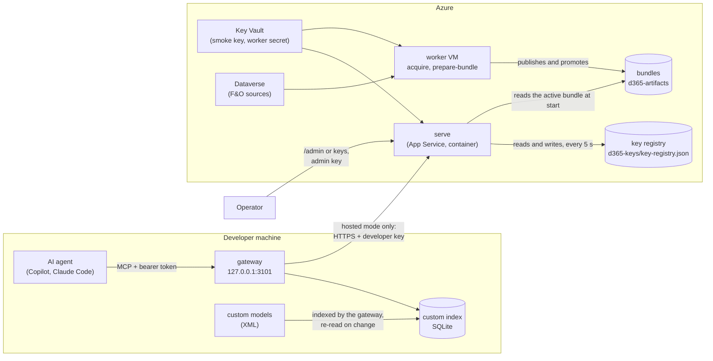

# Architecture, recommendations and cleanup plan

State of `master` at `239ecca` (2026-11-10), after the two-package split, server-side keys and the deploy
walkthrough. Numbers and findings below were measured on that commit: 107 source files (about 27,400 lines),
79 test files (about 25,300 lines), 1,786 passing tests.

## 1. The architecture

### 1.1 Who runs what

| Role | Installs | Runs | Holds |
| --- | --- | --- | --- |
| **Developer** | `d365-fno-mcp-client` (command `d365-fno-mcp`) | `setup`, `gateway`, `doctor` | A developer key (hosted mode only), the custom models |
| **Operator** | `d365-fno-mcp-server` (a clone of the repository for deploying) | `setup --deploy`, `keys`, `artifact`, `serve` | The admin key, Azure access |
| **Azure** | The Docker image and the worker VM | `serve` (App Service), `acquire` and `prepare-bundle` (worker) | Managed identities, the bundles, the key registry |

Two rules shape everything else:

1. **Local indexing only ever covers custom code.** The standard application is indexed only by the worker VM,
   from Dataverse.
2. **Developers cannot create keys.** Keys are made on the server with the admin key.

### 1.2 Runtime picture

- **Local mode**: the right-hand side does not exist. The gateway answers from the custom index alone, offers only
  the tools it can answer, and says so when asked about a standard object.
- **Hosted mode**: merge tools ask both sides and tag rows `local` or `hosted`; custom code never leaves the machine
  (names with a private prefix are not even sent as arguments).

### 1.3 Source layout

| Folder | Lines | Responsibility | In the developer package |
| --- | ---: | --- | --- |
| `src/indexer` | 8,253 | SQLite schema and queries, XML parser, scanner, index build, bundles, Azure Blob store, acquisition worker | Parser, scanner, build and DB only |
| `src/tools` | 4,899 | The MCP tools (metadata, labels, security, entities, generators, code quality, traces, docs, telemetry, writers) | The ones the gateway answers locally |
| `src/cli` | 3,944 | `setup`, `doctor`, `deploy`, `keys`, the worker and import commands, prompt and `.env` helpers | `setup`, `doctor`, checks, prompt |
| `src/gateway` | 3,914 | Config, local and layered index, router, merge strategies, hosted connection | All of it |
| `src/server` | 2,129 | HTTP transport, key registry and admin routes, status, start-up, artifact start-up | Transport, `apiKeys`, status only |
| `src/knowledge` | 1,427 | Knowledge-base filter (embedding model), digest | No |
| `src/workspace`, `src/xpp`, `src/security`, `src/validation`, `src/utils` | 2,516 | Visual Studio workspace discovery, X++ scanner and best practices, security model, grounding, logger | Yes |

Entry points: `src/index.ts` (operator, every command) and `src/clientIndex.ts` (developer, five commands).
`tests/packageBoundary.test.ts` fails the build when the developer entry reaches server start-up, the key registry,
`keys`, `deploy`, the worker commands, the knowledge filter, the artifact stores or an `@azure/*` package.

### 1.4 Request path on the server

Host allowlist → per-IP rate limit → `/admin` (own body parser, admin key) → JSON parser → `/health`, `/live` →
API-key auth (fixed keys, then registry digests) → `/status` and version header → readiness gate → JSON-RPC check →
timeout → `/mcp` sessions. A session is bound to the key that opened it and is closed when that key leaves the
registry.

### 1.5 Data and secrets

| Thing | Where | Who can change it |
| --- | --- | --- |
| Standard index (bundle) | `d365-artifacts` blob container; staged on the API's local disk | Worker identity only |
| Developer and admin keys | SHA-256 digests in `d365-keys/key-registry.json` | API identity, and the operator for `reset-admin` |
| Deploy smoke key, worker client secret | Key Vault | Operator |
| Custom index, gateway token | `./.d365/` on the developer machine, owner-only | The developer |
| Developer key | `.env` (0600) or a key file | The developer |

## 2. Findings that need a decision

These are gaps the last change opened, not style points.

### 2.1 Five optional data features have no home any more (high)

`index-xref`, `index-trace`, `index-bp`, `index-docs` and `index-release-plans` write into a "local index"
(`D365_INDEX_DB_PATH`). After rule 1 a developer has no such index, and hosted bundles carry none of this data
(`docs/hosted-deployment.md` says bundles have no XRef usages because the worker has no SQL Server). So the tools
that read it, `find_usages`, the trace tools, `get_bp_findings`, `search_docs`, `get_doc_page` and the release-plan
tools, can no longer be given data by any supported path. Their code (about 2,300 lines in `src/indexer` and
`src/tools`, plus five commands) is reachable but empty-handed.

Decide per feature, one of:

- **Move it to the worker**: the worker runs the import as a build step and the bundle carries the data. Natural
  for docs and release plans (public sources), possible for XRef if the worker restores the cross-reference
  database, wrong for traces (they hold user names and SQL text and belong to one team).
- **Move it to the gateway**: the import writes into the custom index on the developer machine. Natural for
  `index-bp` (a developer's own compiler logs) and for traces.
- **Remove it**.

Recommendation: docs and release plans → worker; best-practice logs and traces → gateway (custom index); XRef →
worker only if the SQL restore is acceptable there, otherwise remove `find_usages`'s compiler-data path and keep the
metadata-based references.

### 2.2 `serve` still has a "local server" personality (medium)

`serve` without an artifact source opens `D365_INDEX_DB_PATH` directly and prints a client entry; `doctor` still
runs `packages-dir`, `db-*` checks; `index-status` compares an index with `D365_PACKAGES_DIR`; `configLoader`
still reads `D365_PACKAGES_DIR`. None of these has a supported way to get an index now. Either make `serve`
bundle-only (fail without `D365_ARTIFACT_STORE_PATH` or `D365_ARTIFACT_SOURCE=azure-blob`, keep a documented
test-only escape), or state plainly that a self-hosted Docker server with a mounted bundle store is supported and
trim the rest. The second is less work and keeps the Docker smoke test honest.

### 2.3 `D365_GATEWAY_STANDARD_INDEX_DB_PATH` contradicts rule 1 (medium)

It lays a standard index file under the custom one on the developer machine. Nothing builds such a file for a
developer any more; the only source is a bundle's database copied by hand. Either remove the setting and
`src/gateway/layeredIndex.ts` (148 lines, plus the layered paths in `router.ts`, `server.ts`, `localTools.ts`), or
make it a supported feature ("download the active bundle's database with your developer key"). Removing it is
consistent with what was asked.

### 2.4 The deploy walkthrough is unproven end to end (high, before anyone relies on it)

Verified: the questions, the exact script arguments, failure handling, and the blob key registry against real
Azure. Not verified: a full run, the App Service managed identity writing `d365-keys`, and the `-SmokeKeyOnly`
change in `azure-post-deploy.ps1` (PowerShell was not available). Run it once on a throwaway environment before
calling it done.

## 3. Recommendations

### Security

1. **Bind the admin API to a network rule as well as the key.** `allowedIngressCidrs` already exists in the
   template; document that `/admin` should be reachable from operator addresses only, or add
   `MCP_ADMIN_ALLOWED_CIDRS`.
2. **Lock out repeated wrong admin keys.** The limit is 20 requests a minute per address, which is fine against
   guessing a 256-bit key but gives no signal. Add an alert on the `Key administration refused` log line
   (the `authFailureThreshold` alert rule can cover it).
3. **Give developer keys an optional expiry** (`expiresAt` in the registry). Today a key lives until someone
   remembers to revoke it.
4. **Record last use per key** (a date, in memory, flushed rarely) so `keys list` shows which keys are dead.
5. **Rotate the smoke key into the registry** and drop `MCP_API_KEYS` from the template, so there is one key
   system in Azure, not two.
6. **Keep `apt-get upgrade` out of the final image long term**: pin the base image by digest and let Dependabot
   bump it, so image contents are reproducible and the scan result is tied to a known base.

### Reliability and operations

7. **Blob lifecycle for the registry**: confirm the storage lifecycle rules do not age out `key-registry.json`
   versions in a way that matters, and turn on soft delete for the `d365-keys` container.
8. **Health of the registry in `/status`**: it reports `loadedAt`; add `stale: true` when the last re-read failed,
   so an operator sees a replica running on old keys.
9. **Resume for the walkthrough**: it prints the script command to resume from. Store the answers in
   `.d365/deploy-answers.json` (no secrets are in them) so `setup --deploy --resume` can continue at the failed step.
10. **Publish the two packages** from a release workflow, with `npm pack` provenance; until then `npx` in the
    printed commands does not work for anyone.

### Code structure

11. **Split the three largest files**: `indexer/db.ts` (1,453 lines: schema, upserts, queries, labels, xref),
    `gateway/server.ts` (766: catalog, runtime, two server factories, launch) and `cli/doctor.ts` (647: serve
    checks and gateway checks). Split by responsibility, not by size.
12. **One home for CLI messages that tests assert.** Exact sentences live in `setup.ts`, `router.ts`,
    `adminRoutes.ts`, `httpTransport.ts` and `index.ts`; a `messages.ts` per area keeps wording changes to one place.
13. **Add `npm run build:client` to CI** as its own step. The boundary and pack tests cover it today, but a
    build step makes a broken developer build fail fast and obviously.
14. **Adopt `knip`** (or keep the script used for section 4) in `npm run check`, so unused exports cannot build up
    again.
15. **Run CI on Windows for Node 24 too**; the Windows-only failures in the last PR were all in tests, which
    means Windows behaviour is only as good as that one job.

### Documentation

16. README still describes the removed model in places: the feature list names `index` and "the local index",
    the configuration table says `D365_PACKAGES_DIR` is "required by `index`", the optional-data sections show
    `--db-path ./d365_index.db`, and the troubleshooting table has an `index` row. `.env.example` still has
    `D365_PACKAGES_DIR`. Rewrite these once section 2.1 is decided.
17. Keep `docs/architecture.md` (this file) as the one place that states the two rules; link it from README and
    `AGENTS.md`.

## 4. Cleanup plan

Measured with the TypeScript language service over `src/` and `tests/` (references to each exported name).

### Step 1: delete what nothing uses (safe, no behaviour change) — done

| Item | Where | Why it is dead |
| --- | --- | --- |
| `upsertEnumValues`, `upsertDataSources`, `upsertFormControls` | `src/indexer/db.ts:414, 434, 453` | No reference in source or tests; the batched writer replaced them |
| `getLabelSource`, `updateLabelSourceMtime`, `countLabelsFromSource` | `src/indexer/db.ts:533, 539, 556` | No reference |
| `deleteXrefsFrom` | `src/indexer/db.ts:653` | No reference |
| `TraceSession`, `TraceMethod`, `TraceStatement` types | `src/indexer/traceSql.ts:58-60` | No reference |
| `ObjectType` type | `src/validation/grounding.ts:53` | No reference |
| `createProgressLine` and its tests | `src/cli/index-command.ts:63`, `tests/indexProgress.test.ts` | Only the removed `index` command drew it |
| `firstProblem` | `src/cli/checks.ts:15` | Only the removed local setup used it |
| `d365_index.db`, `-shm`, `-wal` in the repository root | untracked, 17 MB | A full local index, which is no longer a thing |
| `.claude/worktrees/` | empty | Left from earlier agent runs |

### Step 2: stop exporting what only its own file uses — done (88 exports)

267 exports are used only inside their own file, 90 of them values (the rest are types that describe a public
shape, which is fine). Remove `export` from the values that no test needs: for example `canonicalFieldType`
(`parser.ts`), `XREF_TABLES`, `DEFAULT_ODBC_DRIVER` (`xrefSql.ts`), `decodeEntities`, `htmlTitle`, `isNoIndex`,
`normalizeIncludes`, `defaultScope` (`docs.ts`), `labelIdCandidates`, `suggestObjectNames` (`db.ts`),
`gatewayConfiguredIn` (`doctor.ts`), `cleanPathAnswer`, `OPERATOR_BIN` (`setup.ts`), `SELECT_KEYWORDS`
(`xpp/scanner.ts`), `declaredTypes` (`fieldAccess.ts`). `runClient` stays exported on purpose: it is the developer entry's
importable function. A rescan after step 1 found no test that imports any of the others.

### Step 3: test-only exports, decide each

13 exports are referenced by tests and by nothing in `src/`, not even their own file:

- **Test fixtures in disguise**: `upsertObject`, `upsertFields`, `upsertProperties`, `upsertMethods`,
  `upsertLabels` (`db.ts`). Tests seed databases with them; production uses the batched writer. Move them to
  `tests/helpers/` so the production module stops carrying a second write path.
- **Probably dead features**: `rollbackArtifactBundle` (`artifactPointers.ts:132`; check whether
  `artifact rollback` uses the Azure store's own rollback and this local one is a leftover), `readKnowledgeEntry`
  (`tools/knowledge.ts:65`), `isMiss` and `textResult` (`gateway/merge.ts`), `xrefPageQuery` (`xrefSql.ts:68`),
  `LAYERED_TABLES` (goes with 2.3). Delete each with its test unless a caller turns up.

### Step 4: remove what the two rules made unnecessary (behaviour changes; needs the decisions in section 2)

| If you decide | Remove |
| --- | --- |
| 2.1: a feature is dropped | Its `index-*` command, its `src/indexer` and `src/tools` files, its tables, tests and README section |
| 2.2: no local `serve` | `index-status` (command, `indexStatus.ts`), the `packages-dir` and `db-*` checks in `doctor`, `checkPackagesDir`, `D365_PACKAGES_DIR` in `configLoader` and `.env.example`, `printServeClientEntry` |
| 2.3: no standard index file | `gateway/layeredIndex.ts`, the `layered` paths in `router.ts`, `server.ts`, `localTools.ts`, the setting and its tests |
| Always | The `index` entry in the help text and its refusal message after one release; the removed-flag refusals in `setup` after one release |

### Order and safety

1. Step 1 and step 2 in one PR: no behaviour change, the suite must stay green untouched except for the deleted
   tests.
2. Step 3 in a second PR.
3. Decide section 2, then step 4 as one PR per decision, each with its README rewrite.
4. Add the unused-export check to CI last, so it guards the cleaned state.
